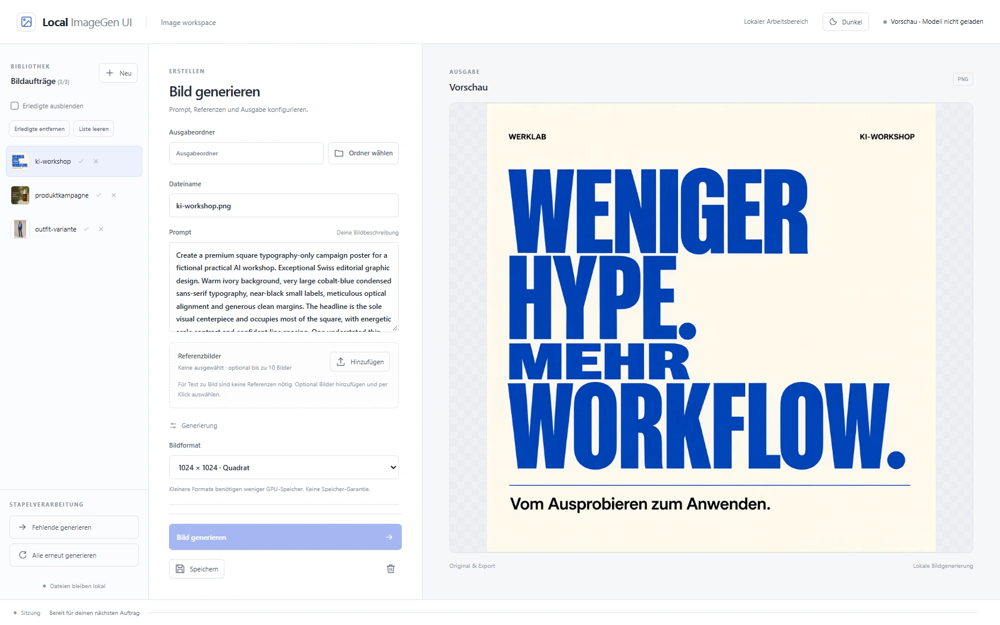

# Local ImageGen UI

> Local image generation and reference editing with Qwen-Image-2.1.

[](https://python.org)
[](https://fastapi.tiangolo.com)
[](https://huggingface.co/Qwen/Qwen-Image-2.1)
[](LICENSE)
[](https://stanm3n.github.io/local-imagegen-ui/)

**Live demo:** [Open Local ImageGen UI →](https://stanm3n.github.io/local-imagegen-ui/)  
*Interface screenshots, nine campaign examples and reference-image editing workflows.*



## Overview

Local ImageGen UI is a Windows application for working with Qwen-Image on local hardware. The German-language HTML/CSS/JavaScript interface connects to a Python/FastAPI backend with a sequential generation queue.

Write prompts, select reference images, choose an output folder and keep image jobs together in one workspace. The [live demo](https://stanm3n.github.io/local-imagegen-ui/) shows the interface, a four-step usage guide and BF16-generated examples. UI screenshots use prepared results; the output-folder path is anonymized.

## Start

You need **Python 3.11**, an NVIDIA CUDA GPU and internet access for the initial downloads.

1. Clone or download this repository.
2. Open `start.bat`. It creates `.venv`, installs the dependencies and downloads the **Turbo Q4** preset.
3. Use the browser at **http://127.0.0.1:7311**.

Open `Modell-waehlen.bat` to choose Q4 or the original BF16 model. The launcher remembers the last successful selection. Stop the running server before switching models.

The gallery was generated with **BF16**. Single-GPU **Q5** inference was tested on an **NVIDIA RTX 3090 (24 GB)**. **Q4** is the default download and has yet to be verified in an inference run.

## Features

- Text-to-image generation and editing with up to ten reference images.
- Saved prompts, editable filenames, seed and advanced generation settings.
- Sequential job queue with progress, cancellation and removable history.
- Native output-folder selection and optional resized export copies.
- Light and dark themes.
- Static result gallery with prompts, settings and original PNGs in [`docs/`](docs/).
- Local HTTP API and an optional agent skill for generation and reference editing.

Before replacing a damaged saved-job library, the app keeps the original as a local `art-manifest.bak` file. Further damaged versions get numbered backups.

Removing a saved entry or clearing job history preserves generated image files. Clearing saved entries cancels their queued jobs; a running job must be stopped separately. The server retains at most 100 completed, failed or cancelled job records, plus active jobs; these records disappear when the server restarts.

## API & Agents

Use the GUI manually or let an agent submit jobs to the same local HTTP API. The application must be running with its model loaded. The GitHub Pages demo is a static showcase; image generation runs on your computer.

| Task | Endpoint |
| --- | --- |
| Check readiness and sampling defaults | `GET /api/status` |
| Submit an image | `POST /api/generate` |
| Follow the returned job ID | `GET /api/jobs` |
| Stop a job | `DELETE /api/job/{job_id}` |
| Upload a reference | `POST /api/refs/upload?name=reference.png` |

Example in PowerShell, after starting the app:

```powershell
$base = "http://127.0.0.1:7311"
$status = Invoke-RestMethod "$base/api/status"
if (-not $status.model_ready) { throw "Load the model before submitting an image." }
$folder = Invoke-RestMethod "$base/api/export-folder"
$body = @{
    file = "agent-poster.png"
    prompt = "A minimalist coffee poster with warm morning light"
    width = 1024
    height = 1024
    steps = $status.default_steps
    cfg = $status.default_cfg
    export_id = $folder.id
    refs = @()
} | ConvertTo-Json
$job = Invoke-RestMethod "$base/api/generate" -Method Post -ContentType "application/json" -Body $body
$job.job_id
```

Poll `/api/jobs` for that exact ID. Once it is `done`, download `image_url` from the same server or use its local `export_path`. Uploaded references are used only when their names appear in the request's `refs` array.

- [API reference and complete submit/poll/download example](skills/local-imagegen/references/api.md)
- [Agent skill: `skills/local-imagegen/SKILL.md`](skills/local-imagegen/SKILL.md)

To use the skill, load its instructions in your agent or copy the complete `skills/local-imagegen` folder into your harness's supported skills directory. The agent needs HTTP or shell access to the running app; cloning the repository alone does not automatically enable the skill. Interactive API docs are available at `http://127.0.0.1:7311/docs` while the local server is running.

## Models

| Option | Backend | Source |
| --- | --- | --- |
| Turbo Q4, default | stable-diffusion.cpp | [Unsloth GGUF](https://huggingface.co/unsloth/Qwen-Image-2.1-Turbo-GGUF) |
| Original BF16 | Diffusers · single-GPU CPU offload or manual dual-GPU mode | [Qwen-Image-2.1](https://huggingface.co/Qwen/Qwen-Image-2.1) |
| Turbo BF16, manual setup | Diffusers | [Qwen-Image-2.1-Turbo](https://huggingface.co/Qwen/Qwen-Image-2.1-Turbo) |

The BF16 launcher uses single-GPU CPU offload by default. A two-GPU workstation can use the manual `QWEN_DEVICE_MODE=dual` configuration described below; GPU-count selection is not automatic.

Q4 needs approximately 12 GB of download space, including the text encoder, vision projector, VAE and CUDA CLI runtime. This download size is not a VRAM requirement. Downloads are resumable and verified against the checksums in [`gguf-models.json`](gguf-models.json). BF16 requires substantially more disk space and system memory.

Base defaults to 30 steps and CFG 1. Turbo uses its checkpoint sigma schedule and CFG 1. Export resizing happens after generation and does not reduce inference memory requirements.

## Storage

| Path | Contents |
| --- | --- |
| `models/` | Downloaded model files and optional CLI runtime |
| `output/` | Full-size generated masters |
| `exports/` | Default export folder |
| `refs/` | Uploaded reference images |
| `art-manifest.json` | Saved image entries |
| `ui-settings.json` | Selected export folder |

**Ordner wählen** opens a folder dialog on the computer running the server. It requires an interactive desktop session and Tk. Each queued job keeps its selected export destination. Existing output filenames receive `_v2`, `_v3`, etc. instead of being overwritten. Reference uploads with the same filename replace that reference; deleting a reference removes the uploaded file.

Loading skips invalid individual manifest entries with a console warning and leaves the saved file unchanged. A malformed JSON document or a non-list document returns a clear error instead of an empty library.

Runtime files, weights and local settings are excluded from Git. Existing manifests using `game_size` are read as `export_size` and saved with the new name.

## Manual setup

Use Python 3.11 for these pinned dependencies:

```powershell
py -3.11 -m venv .venv
.\.venv\Scripts\python.exe -m pip install --upgrade pip
.\.venv\Scripts\python.exe -m pip install torch==2.6.0 torchvision==0.21.0 --index-url https://download.pytorch.org/whl/cu124
.\.venv\Scripts\python.exe -m pip install -r requirements.txt
```

For GGUF, download the selected preset, then start it:

```powershell
.\.venv\Scripts\python.exe setup_gguf.py --quant q4
.\start-gguf.bat
```

`--quant q5` selects the alternative preset. To inspect a download plan without downloading, add `--dry-run`.

For BF16, provide a complete model snapshot and set the paths and device mode before starting:

```powershell
$env:QWEN_BACKEND = 'diffusers'
$env:QWEN_MODEL_DIR = 'D:\Models\Qwen-Image-2.1'
$env:QWEN_DEVICE_MODE = 'offload'
$env:QWEN_GPU_ID = '0'
.\.venv\Scripts\python.exe server.py
```

A Turbo BF16 snapshot uses `QWEN_TURBO_MODEL_DIR` and `server.py --model turbo`. The optional `QWEN_DEVICE_MODE=dual` path was developed on two RTX 3090s; it moves VAE encode/decode to GPU 0 and uses workstation-specific device budgets.

`QWEN_DATA_DIR` changes local runtime storage. `QWEN_EXPORT_DIR` selects the initial export folder. For a UI/API preview without loading weights, run `server.py --no-model` in the prepared environment.

## Limits

See [security notes](SECURITY.md), including the known advisories on the recorded Torch/CUDA profile.

The server binds to loopback and has no user authentication. Keep it local; it is not designed as a shared or internet-facing service. Use a dedicated export directory without symlinks or junctions.

Reference uploads are limited to 16 MiB and checked as images. Large generation formats require explicit opt-in above 1,572,864 pixels; smaller images can still exhaust VRAM. Generative editing can change details beyond the prompt, and transparency presets do not guarantee a clean cutout.

The server loads one model in a background thread on startup. Run one process, without multiple Uvicorn workers.

## Development

```powershell
.\.venv\Scripts\python.exe -m pip install -r requirements-dev.txt
.\.venv\Scripts\python.exe -m unittest discover -s tests
node tests/frontend-startup.test.cjs
node --check static/app.js
.\.venv\Scripts\python.exe -m ruff check .
.\.venv\Scripts\python.exe -m ruff format --check .
```

Ruff is pinned in `requirements-dev.txt`. Text files use LF; Windows batch scripts use CRLF, enforced by `.gitattributes` and `.editorconfig`.

Tests use temporary storage and mocked inference; they do not download models or prove GPU compatibility.

Preview the static results page with:

```powershell
python -m http.server 7312 --bind 127.0.0.1 --directory docs
```

GitHub Pages can serve `main` / `docs`. The gallery links to Hugging Face and does not host model weights or an inference API.

## Licenses

The independently authored application code and documentation use [Apache-2.0](LICENSE). Copyright (c) 2026 Stanm3n.

Model weights and downloaded dependencies keep their own terms. Qwen-Image-2.1 and Turbo use the [Qwen Research License](https://huggingface.co/Qwen/Qwen-Image-2.1/blob/main/LICENSE), which restricts model use to research/evaluation and requires a separate license for commercial model use. See [model and attribution notes](MODEL_LICENSE_NOTICE.md). The application-code license does not grant additional rights to the generated gallery images.
